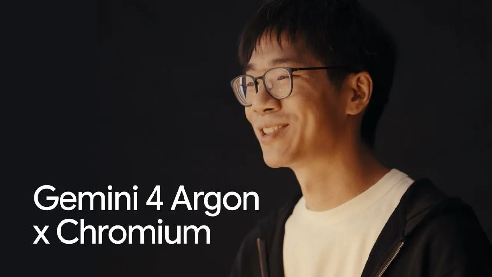
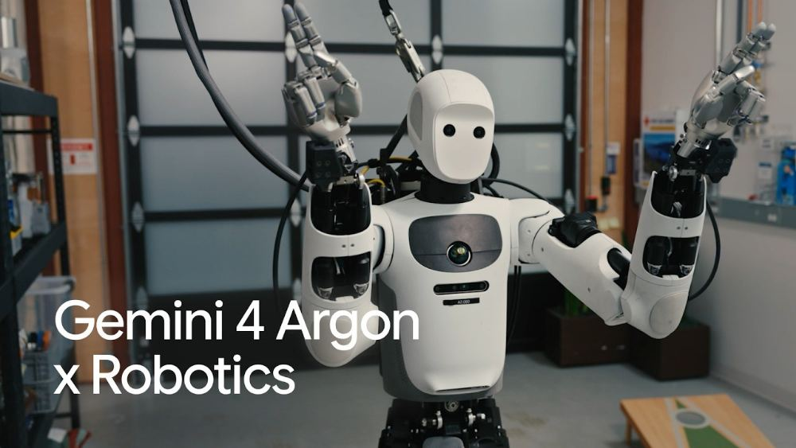

# 谷歌 Gemini 4 Argon 登场：Chrome 一项原需数月的重构，为何几周就完成了？

一个原本以数月估算的浏览器代码重构项目，Google 表示借助 AI 模型，团队在数周内完成了关键工作。

这不是一段简单的代码生成演示，而是涉及 **Chromium 数百个文件**的真实工程任务。

10 月 13 日，Google 发布新一代旗舰模型 **Gemini 4 Argon**，同时披露了代码重构、科研计算和机器人实验等应用案例。

比起模型排名，更值得关注的是：**当 AI 开始参与需要连续分析、修改和验证的复杂任务，它究竟能帮人完成多少工作？**

*图片：Google Cloud 官方发布素材。*

## Chrome 的大规模重构：从数月到数周

先看 Chrome 团队的实际项目。

Chromium 是 Chrome 浏览器背后的庞大开源工程，Google 披露，其代码库规模约 **4000 万行**。其中一个积累多年的浏览器功能目录，包含约 **600 万行代码**。

Chrome 团队想把其中的核心网页处理逻辑重新拆分出来，让浏览器未来能更灵活地处理标签页、侧边栏和悬浮窗口。

这类工作远比生成一个独立组件复杂。

它涉及跨文件的依赖关系、架构设计、连续修改和回归验证。改错一个地方，就可能影响大量用户。

据 Google 官方披露，Argon 参与了这项横跨**数百个文件**的重构，把原本按月计算的工作推进到**数周**。

更值得注意的是，Google 的目标不是让浏览器多一个噱头，而是借此减少页面在不同窗口形态间移动时的重新加载和相关崩溃。

*图片：Google DeepMind 发布的 Chrome 重构演示视频画面。*

类似的案例还有一个：Google 用 Argon 迁移 **700 多个培训实验任务**，同时找出了至少 **16 个**隐藏的超时与竞态问题。官方估算，这项工作节省约 **955 个工程小时**。

要特别说明：这些是 Google 披露的项目成果，不能直接推导为“所有程序员效率都能提高几倍”。

它至少说明了一种变化：

**AI 的角色，正在从编写局部代码，向协助处理跨文件的工程任务延伸。**

## 从视频到动作：一次机器人投掷实验

另一个引人注意的案例来自机器人实验。

研究人员给模型看了一段人类玩 *cornhole* 的视频——这是一种把布袋投进木板洞口的游戏。

模型需要完成的，不只是描述视频里的动作。

它需要从视频中理解空间关系、推算动作，生成可以运行的机器人仿真代码，再把动作方案用于现实中的人形机器人。

Google 展示的内部测试中，Apptronik 的 **Apollo 人形机器人连续 7 次投中**。

*图片：Google DeepMind 发布的 Apptronik Apollo 机器人演示视频画面。*

这次实验值得关注的地方，是它串起了**视频理解 → 物理仿真 → 代码生成 → 真实动作**。

过去，要让机器人掌握一种新技能，往往需要大量专门的仿真建模和动作调试。Google 表示，这类实验流程能把部分原需数周的建模压缩到数小时。

不过，这项实验依赖专门硬件、工程系统与研究人员，**不代表任意机器人都能通过观看视频学会新动作**。

## 从代码到科研：模型还能参与哪些工作？

在量子化学领域，研究者用 Argon 优化了开源软件 **xTB**。

Google 披露，优化后分子结构预测部分任务的运行速度最高达到原来的 **2.3 倍**，构象搜索达到 **1.8 倍**。相关修改已经贡献到该项目的 GitHub 仓库。

另一边，Isomorphic Labs 正用它处理药物研发中的复杂 PDF 和专利资料，将某些过去需要数周的资料梳理工作压缩到数小时。

这些案例并不意味着 AI 已能独立研发新药，体现出的价值主要在于缩短研究者整理资料、编写工具和开展验证前的准备时间。

**对需要大量重复分析的领域来说，时间本身就是巨大的成本。**

## 在不同测试中，Argon 的表现也有差异

Google 公布的评测中，Argon 在 **DeepSWE v1.1** 软件工程测试取得 **77.9%**，高于同表列出的 Claude Opus 5.5 的 **74.2%**。

但在更侧重终端任务的 **Terminal-bench 4.0** 中，Argon 为 **57.4%**，落后于 Claude Opus 5.5 的 **66.4%**。

这恰好说明：不同模型的强项，仍然与具体任务和评测方式有关。官方榜单也不能代替独立复测，更不能保证每个人都得到同样的结果。

对于开发者，与其争论“谁是第一”，不如把自己的真实项目放进相同测试流程里比较。

## 这次升级，普通人能用到什么？

Argon 已面向符合条件的 **Google AI Pro、Ultra** 用户进入 Gemini 应用；开发者可以通过 Google AI Studio、Gemini API 使用，模型标识为 `gemini-4-argon`，具体开放情况取决于账户和地区。

更值得尝试的不是“帮我写一篇总结”，而是给它一个可检查的完整任务。

比如：

**“阅读这三个开源仓库，梳理功能差异，找出重复模块，再给出一套可执行的整合方案，注明证据来源和可能的兼容性问题。”**

对开发者来说，还可以让它先审查迁移方案，再分阶段修改、跑测试、提交变更；重要操作仍要保留人工确认。

另外，API 首发价格也颇有竞争力：

**11 月 30 日前**，每 100 万输入 Token 为 **2 美元**、输出 Token 为 **10 美元**；**12 月 1 日起**将分别调整到 **4 美元**和 **20 美元**。这属于开发者 API 计费，不是订阅月费，实际使用还有工具、缓存和计算量等成本差异。

## 比跑分更值得关注的，是人和 AI 如何协作

过去，我们习惯向 AI 提问，再自己把答案拼成工作成果。

现在，越来越多的 AI 产品开始直接面对代码仓库、办公文件、业务系统和现实世界。

这意味着未来比拼的，不只是模型有多聪明，而是**谁能更可靠地把任务做完、让结果经得起验证**。

Chrome 的这项重构案例提供了一个具体观察窗口：复杂工程中，一部分耗时工作可能逐渐由 AI 协助完成。

**AI 对工作的影响，未必首先表现为岗位变化，也可能先体现在任务分工的调整：人把更多时间用于设计、判断和验证。**

---

**资料来源**

- [Google DeepMind｜Gemini 4 Argon 官方能力、案例与评测](https://deepmind.google/models/gemini/)
- [Google 官方发布｜Gemini 4 Argon](https://blog.google/intl/en-in/products/introducing-gemini-4-argon/)
- [Google AI for Developers｜模型规格与接入](https://ai.google.dev/gemini-api/docs/models/gemini-4-argon)
- [Google AI for Developers｜首发定价与使用说明](https://ai.google.dev/gemini-api/docs/latest-model)

*文中工程、科研和机器人案例均引用 Google 公布的材料；相关效果依赖特定任务、环境及验证流程。*
