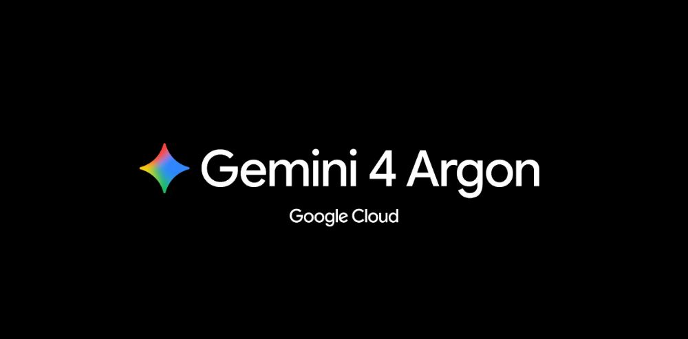

# 谷歌突然放出 Gemini 4 Argon：AI 的下一场争夺战，已经不是聊天了

> **2026 年 10 月 14 日**  
> 一款新的旗舰大模型，正在把 AI 从“回答问题”推向“完成工作”。

10 月 13 日，Google 正式推出新一代旗舰模型 **Gemini 4 Argon**。

乍看之下，这似乎又是一场大模型的参数升级。但真正值得关注的，是 Google 给它安排的任务：**写代码、分析财务文件、研究法律材料，甚至参与复杂科研。**

大模型的战场，开始从“谁回答得更好”，延伸到“谁能把一件复杂的事做完”。

*图片来源：Google Cloud，2026 年 10 月 13 日官方发布资料。*

## 01｜这次升级，重点不只是“更聪明”

Google 将 Gemini 4 Argon 定位为面向复杂现实任务的新一代旗舰模型。

它能同时理解文本、图片、音频与视频；API 提供**最高 100 万 Token 的统一上下文窗口**，并支持 low、medium、high 三档思考强度。

这意味着，在合适的工具与权限配合下，它可以持续处理长材料、拆分多步骤任务，而不只是给出一段看似合理的答案。

举个例子：以前你让 AI“帮我优化代码”，得到的可能是一段修改建议。

现在，像 Argon 这样的模型瞄准的是另一种工作方式：**阅读项目、定位问题、修改多个文件、运行验证，再交付可检查的结果。**

当然，模型有能力处理长任务，并不等于所有任务都能一次成功。关键修改仍需要测试和人工审核。

## 02｜Google 自己，已经拿它做了什么？

最有看点的，不是宣传片，而是 Google 公布的内部应用案例。

**第一件事：改造大型代码库。**

Google 表示，Argon 帮助 Chrome 团队处理 Chromium 中横跨数百个文件的架构重构工作；其开发团队使用 Argon 后，Agent 生成代码的提交量增长超过 **35%**，代码回滚减少接近三分之一。

需要注意：这是 Google 披露的**内部应用数据**，并不意味着所有开发团队都能获得相同提升。

**第二件事：处理高强度专业工作。**

在金融、法律和企业知识工作中，Argon 被用来分析长文档、交叉核对材料、梳理条款和生成有来源依据的结果。

**第三件事：辅助科研与安全防御。**

Google 披露了量子计算、酶设计和网络安全相关探索。不过，这些案例分别依赖具体研究流程与人工验证，不能简单理解为“AI 已经能独立完成科学发现”。

这三个方向指向同一件事：**AI 的价值，越来越多地体现在真实工作流里。**

## 03｜普通人和开发者，怎么用？

对于普通用户，Google 已开始向 **Gemini 应用的 Google AI Pro 和 Ultra 订阅用户**开放 Argon，并接入搜索 AI Mode；实际可用性仍受地区、账户和滚动推送影响。

开发者可以通过 **Google AI Studio、Gemini API** 接入，模型 ID 是 `gemini-4-argon`。Google AI Ultra 用户还能在 Antigravity 中使用。

价格值得留意：Google 提供的是**有期限的首发价**。

**首发价（截至 2026 年 11 月 30 日）：**

- 输入：每 100 万 Token **2 美元**
- 输出：每 100 万 Token **10 美元**

**2026 年 12 月 1 日起：**

- 输入：每 100 万 Token **4 美元**
- 输出：每 100 万 Token **20 美元**

这里的价格是 **API 费用**，不等于 Gemini 订阅费；输出计费包含模型思考 Token。具体使用前，仍应查看最新官方计费页面。

如果你从事编程、内容研究、行业分析或复杂资料整理，最值得试的不是简单问答，而是把一个真实任务交给它，再检查最终交付物。

## 04｜比模型跑分更重要的变化

过去，人们比较 AI，常常问：“它懂不懂这道题？”

接下来，越来越多人会问：“**这个项目，你能不能从头做到尾？**”

从 ChatGPT、Claude 到 Gemini，竞争正在深入代码库、文件系统和企业流程。

Gemini 4 Argon 的发布，并不能单凭官方跑分就证明它全面领先所有对手；但它清晰释放了一个信号：**大模型的下一阶段，拼的是复杂任务的完成能力，而不只是聊天体验。**

---

**资料来源**

- [Google 官方发布：Gemini 4 Argon](https://blog.google/intl/en-in/products/introducing-gemini-4-argon/)
- [Google Cloud：Gemini 4 Argon 企业应用](https://cloud.google.com/blog/products/ai-machine-learning/gemini-4-argon-available-on-google-cloud)
- [Google 开发者文档：模型特性、接入与定价](https://ai.google.dev/gemini-api/docs/latest-model)
- [Google DeepMind：Gemini 4 Argon Model Card](https://deepmind.google/models/model-cards/gemini-4-argon/)

*编辑说明：截至北京时间 2026 年 10 月 14 日；本文依据 Google 官方资料整理，涉及内部成绩均按官方口径归属。*
