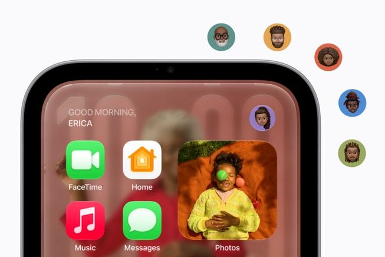
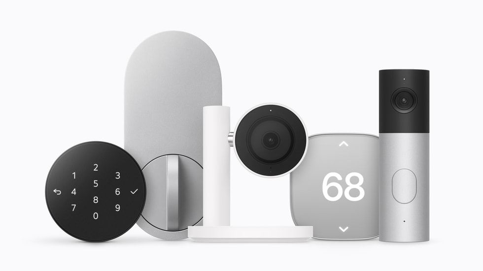

# 苹果把 Siri 带进了客厅：能认人、看家、管设备，HomeView 想成为家庭新入口

想象一个场景：

你正在厨房做饭，不用拿出手机，只要开口就能查看下一步食谱；门铃响了，旁边的屏幕显示是谁到了门口；到了晚上，还能顺手检查家里的门锁、灯光和温度。

**苹果想把这些原本分散在手机、智能音箱和各类 App 里的操作，放进家里同一块屏幕。**

10 月 13 日，Apple 发布了 **HomeView**：一款配备 **7 英寸屏幕**、搭载全新 **Siri AI** 的家庭设备，美国起售价 **299 美元**。

它可以识别不同家庭成员、显示个人信息、查看摄像头、控制智能家居，也能进行 FaceTime 通话和播放音乐。

与它同时公布的，还有苹果联手合作伙伴打造的一整套摄像头、门锁、温控器等设备。

这场发布的重点，因此不只是“一款带屏幕的 HomePod”，而是苹果试图把 Siri 变成**整个家庭的交互入口**。

*图片来源：Apple Newsroom。*

## 先认出是谁，再决定显示什么

家里的智能设备和手机不一样。

手机通常属于一个人，家庭屏幕却可能由父母、孩子、伴侣轮流使用。有人想听音乐，有人想看日程，有人只想快速确认家里的温度。

HomeView 的第一项关键设计，就是**通过人脸识别区分最多 6 位家庭成员**，并为每个人切换不同的主屏幕、应用和小组件。

你靠近时，它可以显示属于你的信息；其他家人靠近，又能切换成他们自己的布局。共享音乐、相册等内容则可以让全家共同使用。

苹果还让界面根据观看距离变化：站得远，信息更简洁；走到屏幕前，才展示更丰富的细节。

这块 7 英寸 Liquid Retina 屏幕支持 True Tone，亮度能从 **500 尼特**降至 **0.3 尼特**。这些设计显然是为了让它能长期放在厨房、床头或客厅，而不需要像手机一样随用随拿。

*图片来源：Apple Newsroom。*

但“认得出你”不代表“任何时候都能展示你的隐私”。

苹果表示，像信息和日历这样的个人内容，还需要确认本人身份，并满足**已配对的 iPhone 或 iPad 在附近、近期解锁**等条件。

这也是家庭共享设备必须解决的问题：便利，不能以随意暴露每个人的私人信息为代价。

## Siri 不再只负责开灯，还想听懂你的上下文

过去的智能音箱很擅长执行简单命令。

“放一首歌。”

“把客厅灯关掉。”

但如果你追问一个问题，或者希望它结合日历、信息和屏幕上的内容做判断，体验就会复杂得多。

HomeView 搭载的新一代 **Siri AI**，正试图解决这个问题。

按照苹果的介绍，新 Siri 可以进行更自然的连续对话，理解屏幕上的内容，并结合广泛的知识回答问题。

当 HomeView 与支持 Apple Intelligence 的 iPhone 或 iPad 配对后，它还能在获得相应权限的情况下，利用用户的**日历、信息、音乐偏好等个人上下文**提供更贴近个人的帮助。

例如，询问今天的安排、继续讨论屏幕上的信息，或将 HomeView 上开始的 Siri 对话接续到 iPhone、Mac 等其他设备。

值得注意的是：**并不是所有 Siri AI 能力都由 HomeView 独立完成。** 深度个性化请求需要兼容的配对设备，部分功能还存在语言、地区和测试版限制。

苹果真正想做的，是让 Siri 从一个需要专门唤醒的语音工具，逐渐变成**人在家里随时能与之交流的助手**。

## “看家”是更实际的需求：门口发生了什么，屏幕直接告诉你

除了聊天，HomeView 可能最常被用到的场景之一，是家庭安防。

它可以接入兼容的智能摄像头，在一个画面中同时显示**最多 9 路视频**。你不必每次都打开手机 App，就能看看门口、庭院或其他区域的实时画面。

配合符合要求的 **iCloud+ 订阅、摄像头和 Apple Intelligence 设备设置**，系统还可以识别人、熟悉的面孔、宠物、包裹和车辆，并为部分 HomeKit Secure Video 片段生成文字说明。

比方说，摄像头检测到门口有包裹，你看到的不再只有一条抽象的移动提醒，也可能是一条更容易理解的事件信息。

苹果还表示，HomeView 能识别烟雾或一氧化碳报警器发出的警报声，并向 iPhone、iPad 或 Apple Watch 发送提醒。

这些能力有其设备及订阅要求，也不能代替正规的报警器或独立安防系统。

但它让“智能家居屏幕”拥有了一个明确用途：**不只是控制设备，还能让家里发生的事情更容易被看见、被理解。**

## 真正的后手，是摄像头、门锁和温控器一起协作

单独一台 HomeView，能做的事终究有限。

苹果也很清楚这一点，所以同场公布了 **Apple Home Collection**：由苹果与 **LG Electronics、Schneider Electric** 合作设计的智能家居配件系列，包含摄像头、可视门铃、门锁、温控器和传感器。

*图片来源：Apple Newsroom。*

这套产品真正有意思的地方，是它们可以参与同一套家庭自动化流程。

例如，家中最后一个人出门时，系统可以根据设置调整空调、检查门锁、恢复摄像头监控；有人即将到家时，再提前调节温度。

苹果还展示了智能门锁的其他使用方式：兼容的 iPhone 或 Apple Watch 靠近时自动解锁，或为临时到访的家人、客人分配访问权限。

对用户来说，这样的体验比“我能用手机远程打开一个开关”更进一步。

它关注的是一件事：**多个品牌、多个房间、多个设备，能否像一套系统那样协作。**

Apple Home Collection 的配件可以通过 Apple Home 统一管理，无需为该系列每个设备单独创建账号。HomeView 也继续兼容符合条件的 Works with Apple Home 和 Matter 设备。

不过，配件需要单独购买，部分功能也取决于具体型号、网络环境和配对设备，并非买一台 HomeView 就自动拥有整套智能家庭。

## 它还得解决一个问题：为什么不直接用 iPad？

如果 HomeView 只能显示摄像头和控制灯光，那很多人完全可以拿旧 iPad 替代。

所以苹果还给它增加了很多更日常的功能。

它支持 **FaceTime 视频通话、Apple Music、播客、家庭照片、跨房间广播**；在厨房，可以将网上的食谱整理成步骤，配合免手操作的计时器。

*图片来源：Apple Newsroom。*

与 iPad 不同，HomeView 从设计之初就是一件固定放在家里的共享设备。桌面版把屏幕与音箱底座结合，另有壁挂版本，适合玄关或走廊等位置。

苹果希望它每天都有被使用的理由：做饭时看步骤，吃饭时听音乐，有人按门铃时查看门外，睡前检查家里的设备。

**真正决定 HomeView 能否站稳脚跟的，不是它能做多少件事，而是全家人是否会自然地用上它。**

## 299 美元只是入门，完整体验还有门槛

HomeView 的美国起售价为 **299 美元**，桌面版与壁挂版均从这一价格起。部分壁挂安装配件另行收费。

苹果公布的首批上市日期为 **11 月 13 日**，覆盖美国、英国、加拿大、澳大利亚、印度、新西兰等市场；新加坡和南非也在已公布的销售安排中。

**目前并没有公布中国大陆的正式售价和上市日期。**

更重要的是，Siri AI 在 HomeView 上首批支持的主要是指定国家和地区的**英语**。中文体验、完整个人上下文功能及部分智能安防能力，还不能直接按英文演示推断。

至于同步发布的 Apple Home Collection，苹果计划从 **12 月**开始陆续销售，部分产品要到 **2027 年初**才上市。

因此，299 美元买到的是家庭 AI 入口的硬件；要实现完整的安防和自动化体验，仍可能需要额外的摄像头、门锁、温控设备、配对终端和订阅服务。

---

从 Siri AI 到家庭成员识别，从摄像头到自动门锁，苹果这次实际上在做一件比发布智能屏幕更大的事：

**让原本分散在不同设备上的家庭服务，逐渐围绕一个共享入口运转。**

HomeView 是否值得买，最终取决于 Siri 的实际表现、第三方设备的兼容程度，以及用户是否愿意为一整套体验付费。

它未必会取代 iPad，也未必适合每个家庭。但它清楚表明，苹果正在认真争取一个新位置：**智能家居的控制中心。**
