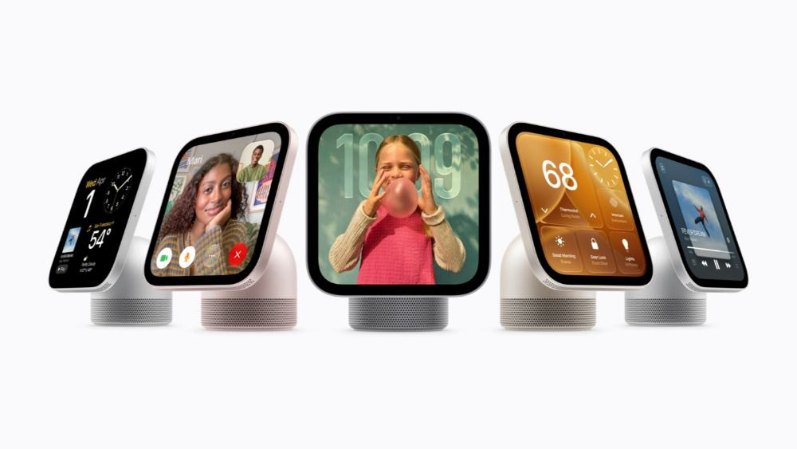

# 苹果终于把 AI 搬进客厅：299 美元的 HomeView，想取代的可能不是 iPad

如果家里只能有一块公共屏幕，你希望它做什么？

播放音乐、查看门口摄像头、提醒日程，还是在你做饭时，直接告诉你下一步该放什么食材？

10 月 13 日，苹果发布了 **Apple HomeView**。这不是另一台 iPad，而是一款专门面向全家人的**智能家庭屏幕**。

它的美国起售价是 **299 美元**，首批市场将于 **11 月 13 日**正式开售。

*图片来源：Apple Newsroom，官方发布的 HomeView 产品阵容。*

## 01｜看上去像一台小屏幕，定位却很不一样

HomeView 配备一块 **7 英寸 Liquid Retina 显示屏**，搭载 A18 芯片。

桌面款把屏幕连接在圆顶形音箱底座上，屏幕可调节观看角度；另有独立的壁挂款，适合放在玄关、走廊等位置。

桌面款提供银色、星光色、玫瑰粉色和深空灰色四种颜色。壁挂款则提供银色和深空灰色。

这款产品有一个非常明确的设定：**它是整个家庭共用的设备，而不是某个人的私人平板。**

## 02｜真正的看点，是能“认人”的 Siri AI

HomeView 可以通过人脸识别，为最多 **6 位家庭成员**切换不同的个人主屏幕与内容。

同样一块屏幕，爸爸走近看到自己的日程，妈妈走近看到自己的提醒；共享相册和音乐也可以被全家使用。

而全新的 **Siri AI**，不只是接收“开灯”“放歌”这样的语音指令。

苹果表示，它具备更自然的对话能力、屏幕内容理解能力，以及面向个人上下文的协助能力。

但有一个重要前提：**部分个性化能力需要配对支持 Apple Intelligence 的 iPhone 或 iPad**，而不是所有功能都能由 HomeView 单独完成。

苹果也为个人内容设置了额外保护条件，例如识别本人、配对设备在附近且近期解锁，避免家庭公共屏幕随意展示私人信息。

## 03｜它能把智能家居变成什么样？

*图片来源：Apple Newsroom，HomeView 厨房使用场景。*

**在厨房**，你可以让它把网上的食谱整理成分步骤指引，并用语音设置计时器。

**在客厅**，它可以播放音乐、显示照片、使用 FaceTime 通话，还能查看家庭日程和提醒事项。

**在玄关**，它能展示摄像头画面、调整灯光和温控设备、控制门锁与窗帘；官方表示最多可以在一个界面查看 9 路视频画面。

支持的智能家居配件包含 Works with Apple Home 与 Matter 生态设备；某些摄像头识别和录像能力需要兼容设备及相应 iCloud+ 订阅。

如果说 iPad 主要围绕“一个人使用的应用”，HomeView 更像是一个**常亮待命、随时能交互的家庭控制台**。

## 04｜299 美元，真的人人都能买到吗？

根据苹果 10 月 13 日的新闻稿，**299 美元是美国售价**，桌面款和壁挂款均从这一价格起步；壁挂配件另行购买。

首批预购和 11 月 13 日上市覆盖美国、英国、加拿大、澳大利亚、印度和新西兰等已公布市场；新加坡和南非的购买渠道另有安排。

**截至 10 月 14 日，苹果尚未在这份发布公告中给出中国大陆上市日期与人民币定价。**

此外，苹果公布的 HomeView Siri AI 首批支持语言以英语为主，支持地区也有限制。因此，中文交互体验与中国大陆正式销售情况，仍要等待进一步公告。

## 苹果为什么现在做这块屏幕？

智能家居过去不缺设备，缺的是一种让全家人都愿意使用的入口。

音箱没有屏幕，平板未必一直固定在家里；手机能控制家居，却始终更像私人设备。

HomeView 想补上中间的空白：**让 AI 随时出现在家里，让复杂的智能家居操作变得像说话一样自然。**

决定它能不能成为爆款的，或许不是这块 7 英寸屏幕，而是 Siri AI 能否真正理解家庭成员的需求，以及不同品牌的智能设备能否稳定配合。

---

**资料来源**

- [Apple Newsroom：HomeView 正式发布（2026 年 10 月 13 日）](https://www.apple.com/newsroom/2026/10/meet-apple-homeview-a-new-way-to-enjoy-entertainment-and-manage-the-home/)
- [MacRumors：Apple HomeView 产品与规格汇总](https://www.macrumors.com/roundup/apple-homeview/)

*编辑说明：截至北京时间 2026 年 10 月 14 日。价格、上市时间与功能支持以苹果官方对应国家或地区页面为准；正文配图来自 Apple 官方发布素材。*
