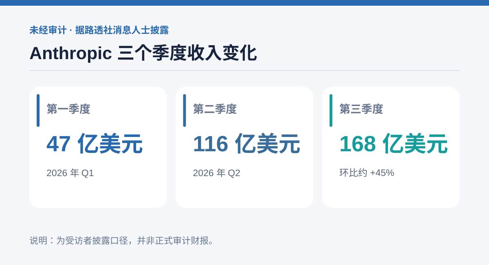

# Anthropic 季度收入据称达到 168 亿美元：增长、盈利与天价 IPO 预期，哪些数字最值得看？

Claude 背后的 Anthropic，正在向潜在投资者展示一份增长速度惊人的成绩单。

据路透社援引参加投资者活动的人士披露，Anthropic 在 2026 年第三季度的收入达到 **168 亿美元**，较第二季度的 116 亿美元增长约 45%。公司还在活动中向投资者表示，第三季度按调整后口径实现盈利。

不过，这些数字来自与会者的转述，**并非已公布并审计的财报**。这是理解这次消息首先要区分的界限。

## 收入为何成为全场焦点

同一批消息人士称，Anthropic 第一季度收入约为 47 亿美元，第二季度升至 116 亿美元，第三季度进一步增长到 168 亿美元。

*图：根据本文援引的路透社消息人士披露数据制作；未经审计。*

连续几个季度的收入放大，说明生成式 AI 的商业需求已经不只停留在体验阶段。对于 Claude 这样的模型平台，收入既可能来自企业和个人订阅，也可能来自通过合作伙伴提供的模型调用服务。

但仅看总收入还不够。模型服务背后的算力采购、推理成本、销售费用和客户留存率，才决定这种增长能否持续。

## 调整后盈利不等于没有成本压力

报道所说的「调整后盈利」与按统一会计准则计算的净利润并非一回事。

路透社此前报道称，Anthropic 去年仍承受巨额经营亏损。最新投资者沟通中的盈利口径如何调整、是否包括全部算力承诺支出，都需要等待进一步披露。

公司还据称预测，到年底的年化收入运行速度可达 1100 亿美元。**年化运行速度是按照某一时点的收入节奏推算，并不等于已经实现的全年收入。**

## 估值为何可能突破两万亿美元

据报道，Anthropic 正争取超过 2 万亿美元的上市估值。这样庞大的估值意味着投资者不仅需要相信模型能力，还要相信企业采购和算力效率能在未来几年持续改善。

其合作伙伴关系也很特别：Google 和 Amazon 不仅是投资者，也是算力供应方和分发渠道，同时又在 AI 市场参与竞争。

这使 Anthropic 的商业前景与云计算产业链紧密交织。

## 从产品竞争走向财务竞争

投资者越来越关注，谁能把高水平模型变成规模化、可重复付费的业务。

Anthropic 在投资者活动上展示了利用 AI 协助自身芯片设计等场景，但这并不代表所有企业都已经能复制这种能力。

下一阶段的关键问题，是收入增长、算力投入、经营利润和现金流能否同步改善。相比单一模型跑分，这些财务指标将更直接地决定 AI 公司的长期价值。