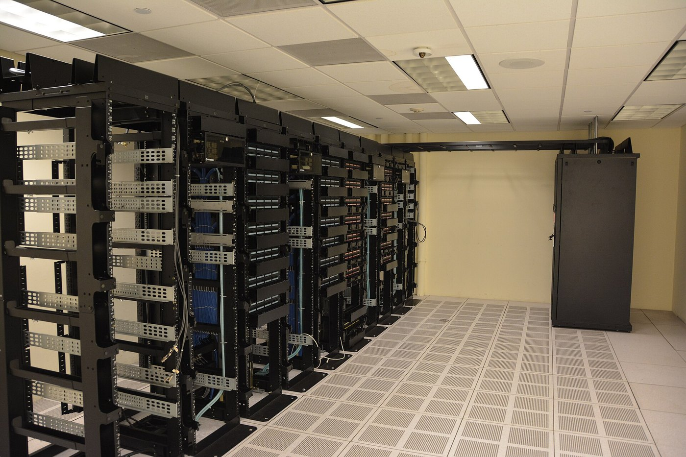

# AI 算力股集体下跌：CoreWeave 债券收益率升至约 15%，市场究竟在担心什么？

AI 算力需求仍然旺盛，但华尔街正在重新计算建设算力所需要的钱。

美国最新通胀数据公布后，CoreWeave、Nebius、Oracle 和 Dell 等 AI 基础设施相关股票在同一交易日明显下跌。路透社统计，四家公司的市值合计减少约 **800 亿美元**。

这不是 AI 技术突然失效，而是金融市场开始更严格地审视高投入商业模式。

*配图：数据中心服务器机架资料图片（非 CoreWeave 机房）；图片：Carl Lender，CC BY 2.0。资料图片，不代表本次新闻事件的实际现场。*

## 一份通胀数据如何传到数据中心

美国通胀升温，推动投资者提高对利率长期维持高位、甚至进一步上调的预期。

对依赖贷款、债券和融资租赁建设服务器机房的企业来说，更昂贵的资金意味着更高的新增项目成本。

GPU 采购、电力接入、土地和冷却设施都需要先投入巨额资金，收入却往往依靠未来数年的客户合同逐步回收。

因此，利率变化可能影响数据中心企业的估值，即使它们手里仍有订单。

## CoreWeave 的债券究竟发生了什么

路透社援引 LSEG 数据称，CoreWeave 已发行规模可观的债券和贷款，其中一只在发行时收益率为 9.625% 的债券，近期二级市场收益率升至约 **15%**。

需要注意，**债券二级市场收益率上升，并不代表企业已有固定票息自动上升到 15%**。通常是市场价格下跌，使按当前价格买入所对应的收益率提高。

这一变化反映投资者要求更高风险补偿，也会对未来再融资造成压力。

Reddit 的 r/wallstreetbets 和相关投资社区围绕 CoreWeave 债务风险出现讨论，但网友推测的违约时间、政府救助或某家巨头收购，都不能当成已发生的事实。

## 为什么不能把所有 AI 公司混为一谈

资金充足、主营业务有稳定现金流的大型云平台，与主要依靠持续融资扩张的新兴算力供应商，面临的风险并不相同。

前者可以利用既有利润支持部分投资，后者更容易受到资本市场利率与风险偏好的变化影响。

此外，签约订单金额不等于当期营业收入，更不等于可自由支配的现金。合同期限、交付进度和客户履约能力都需要单独分析。

## 下一步真正值得看的指标

判断 AI 基础设施能否穿越市场波动，不能只看股价涨跌。

更重要的是企业债务到期结构、现金流、融资成本、实际交付的算力、客户合同执行，以及 GPU 更新换代带来的资本支出。

当 AI 行业从「增长有多快」进入「投资回报有多好」的阶段，这些指标会越来越重要。