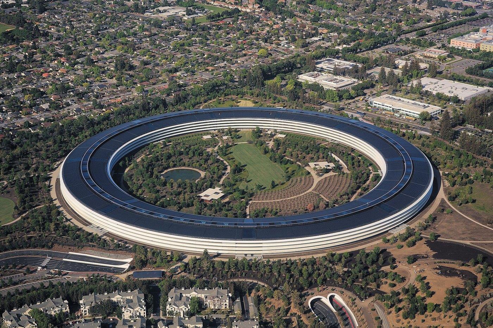

# OpenAI 与苹果打起商业秘密官司：未发布 AI 设备、员工跳槽与证据争议

AI 硬件竞争还没有完全进入大众市场，围绕人才和机密文件的法律争议已经出现。

根据路透社披露的美国法院文件，OpenAI 指控一名离职并加入苹果的员工，将涉及未发布产品的逾百份文件发送至个人账户，并称其曾向苹果高层介绍相关信息。

**这是 OpenAI 提出的指控。苹果已表示，没有发现支持这些说法的证据。**

*配图：苹果 Apple Park 办公园区（2025年拍摄）；图片：Daniel Lawrence Lu (IPhone01)，CC BY-SA 4.0。资料图片，不代表本次新闻事件的实际现场。*

## 未发布设备为何会成为争议核心

与通用聊天机器人不同，AI 设备设计可能涉及交互方式、硬件布局、传感器选择和产品定位等大量未公开信息。

新产品还没上市时，这些内部文件可能构成企业重要的商业秘密。企业既希望吸纳有经验的工程师，也需要避免前雇员带入上一家公司的受保护资料。

法律上，员工在工作中获得的通用技能与可受保护的机密资料并不是同一回事。

## 双方究竟各自指控了什么

路透社报道，这次文件争议属于一场更大的商业秘密诉讼。

更早之前，苹果曾指控离职员工带走其机密信息，进入 OpenAI 的硬件部门；OpenAI 否认该项指控。

如今 OpenAI 又提出前员工向苹果带走相关文件的说法。两组指控方向相反，但**彼此不能互相证明**。

苹果在提交给法院的材料中表示，调查相关工作资源后未发现 OpenAI 文件，并要求 OpenAI 提供更多信息。

## 法院目前走到了哪一步

报道显示，法院已允许苹果对部分相关数字资料进行提前取证，并批准加快部分证人证言程序。

提前取证意味着法院允许收集材料，不代表法院认定某一方已经侵权。

这类案件往往需要进一步核实文件究竟包含什么、由谁接收、是否受保密义务约束，以及是否在具体产品研发中被不当使用。

## AI 硬件竞争为什么值得长期关注

聊天模型可以通过 API 提供给其他软件，但实体设备需要把模型、交互、芯片和应用生态组合起来。

苹果长期擅长消费硬件和操作系统生态，OpenAI 则拥有模型和 AI 交互层面的能力。双方可能既有合作需求，也存在产品竞争。

这场诉讼的价值，不在于立即判断哪家公司「偷走了技术」，而是提醒人们：AI 的下一轮争夺已经延伸到人才流动、硬件研发与知识产权保护。